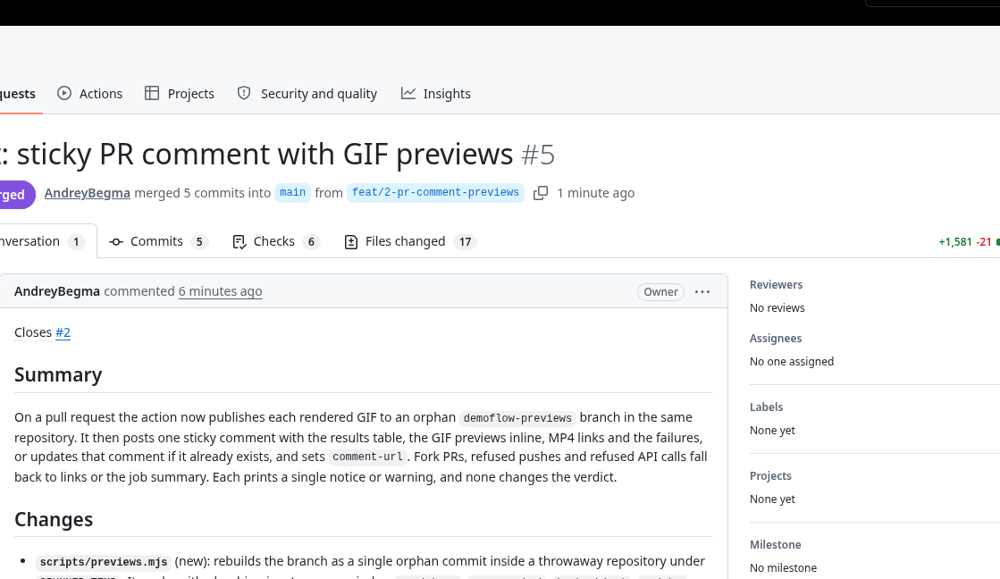

# DemoFlow Demo Videos

Run every [DemoFlow](https://github.com/AndreyBegma/DemoFlow) scenario of your project on each pull request. The action uploads the rendered videos as a workflow artifact, posts **one sticky comment** with a results table and inline GIF previews, and fails the check when a demo fails.



*A real comment from this repository's own self-test.*

- Runs `demoflow/**/*.demo.json` with the published `demoflow` npm package, one scenario after another, never stopping at a failure.
- Uploads MP4s, GIFs and `result.json` as one artifact (`artifact-name`).
- Writes the same table to the job summary on every event, pull request or not.
- Updates its comment in place on every push; it never adds a new one.
- Nothing leaves GitHub: see [Privacy](#privacy-and-adr-0008).

## Quick start

Add `.github/workflows/demoflow.yml` to the repository that holds `demoflow.config.json`:

```yaml
on: pull_request
permissions:
  contents: write        # GIF previews branch (optional, see "Previews")
  pull-requests: write   # the sticky comment
concurrency:
  group: demoflow-${{ github.ref }}
  cancel-in-progress: true
jobs:
  demos:
    runs-on: ubuntu-latest
    steps:
      - uses: actions/checkout@v7
      - uses: actions/setup-node@v7
        with: { node-version: 22 }
      - run: npm ci          # the app's own dependencies: devCommand needs them
      - uses: AndreyBegma/demoflow-action@v1
        env:
          APP_PASSWORD: ${{ secrets.APP_PASSWORD }}   # secrets a scenario reads
```

The same file lives in [`examples/demoflow.yml`](examples/demoflow.yml) with third-party actions pinned by commit SHA. Reference the action as `@v1` (moves with every `1.x.y` release) or pin a full commit SHA.

## Permissions

| Permission | What it enables | Without it |
|---|---|---|
| `contents: write` | Publishing GIF previews to the previews branch | The comment links the artifact instead of showing GIFs |
| `pull-requests: write` | Creating and updating the sticky comment | No comment; the job summary and the artifact still carry the results |
| *(none beyond `contents: read`)* | Running scenarios, the artifact, the job summary and the verdict | Nothing is lost |

Problems with the artifact, the comment or the previews branch are warnings. They never change the verdict: only the final step decides whether the check passes.

## Inputs

<!-- inputs:start -->
| Input | Default | Description |
|---|---|---|
| `version` | `0.6.0` | Exact demoflow version to install (>= 0.6.0; no range, no `latest`). |
| `working-directory` | `.` | The project root, which holds demoflow.config.json. |
| `scenarios` | `demoflow/**/*.demo.json` | Globs relative to working-directory (`*`, `**`, `?`), one per line, matched against `demoflow check`'s scenario list. |
| `formats` | `gif,mp4` | Comma-separated render formats, passed as repeated --format. Empty uses the project's render.formats. |
| `port` | *(empty)* | Passed as --port to every run (fills ${PORT} in baseUrl and devCommand). |
| `comment` | `true` | Post or update the sticky PR comment (pull request events only; needs pull-requests write). |
| `previews` | `true` | Publish GIFs to the previews branch for inline display (needs contents write). |
| `previews-branch` | `demoflow-previews` | The orphan branch for GIF previews; the action rewrites it on every publish. |
| `max-gif-size-mb` | `10` | Larger GIFs are not embedded in the comment; the row links the artifact. |
| `previews-retention-days` | `30` | Preview directories older than this are pruned. |
| `artifact-name` | `demoflow-videos` | Artifact name; must be unique per workflow run (set it per matrix leg). |
| `retention-days` | `14` | Artifact retention in days. |
| `fail-on-error` | `true` | Fail the step when any scenario exited non-zero. |
| `github-token` | `${{ github.token }}` | Token for the PR comment and the previews branch. |
| `node-version` | *(empty)* | Empty uses node on PATH when it is >= 22, else sets up Node 22. Set, always runs actions/setup-node with it. |
| `cache-browsers` | `true` | Cache Chromium with actions/cache. |
| `install-system-deps` | `true` | Linux only, install Chromium's system libraries with `playwright install-deps chromium` (needs sudo). |
<!-- inputs:end -->

## Outputs

<!-- outputs:start -->
| Output | Description |
|---|---|
| `results` | Absolute path of results.json. |
| `total` | Number of scenarios run. |
| `passed` | Scenarios that exited 0. |
| `failed` | Scenarios that exited non-zero. |
| `artifact-url` | URL of the uploaded artifact (empty when nothing was uploaded). |
| `comment-url` | URL of the sticky comment (empty when none was posted). |
<!-- outputs:end -->

A scenario counts as failed on any non-zero exit: a failed verification (`1`), invalid input or a readiness failure (`2`), or a recording or rendering failure (`3`). A failed verification is still rendered; the video is the evidence.

The two tables above are checked against `action.yml` by a unit test (`test/readme.test.mjs`); if they drift, the test fails.

## App startup

The action does not start your app; `demoflow run` does, from `devCommand` in your `demoflow.config.json`, and stops it after each scenario.

- **Install the app's dependencies first** (`npm ci`, as in the quick start). `devCommand` needs them.
- **`devCommand` runs without a shell.** On Windows runners use `node` (or the real executable), not `npm`: `npm.cmd` is not started without a shell.
- **Port.** Put `${PORT}` in `baseUrl` and `devCommand` and set the `port` input when the default port is taken on the runner. The action passes `--port` to every run.
- **No `devCommand`?** Start the app in an earlier step.
- **Secrets** a scenario reads go in the action step's `env:`, as `APP_PASSWORD` does in the quick start. Do not put them in `with:`.

## Fork pull requests

GitHub gives a `pull_request` workflow from a fork a read-only token, so for those pull requests the action can write **neither the comment nor the previews branch**. It detects a fork, skips both, and prints one notice. Runs, the artifact, the job summary and the verdict work as usual: look there.

> **Do not use `pull_request_target` to work around this.** It runs with a write token and secrets, and this action would then execute the fork's scenarios and its `devCommand` with them. That is arbitrary code from a stranger with your credentials. `pull_request_target` is not supported.

## Previews

GitHub cannot embed an artifact in a comment, so GIFs are committed to an **orphan branch of the same repository** (`demoflow-previews` by default) and embedded by URL. No other host is involved.

- **Public in a public repository.** Anyone can open the branch. A GIF shows whatever the scenario typed and displayed: mask sensitive elements in the scenario, or opt out.
- **Pruned.** Every publish rewrites the branch as a single commit, so history never keeps old GIFs. A pull request's older preview directories are replaced, and directories older than `previews-retention-days` (30) are removed.
- **Guarded.** The action refuses to rewrite the default branch, the pull request's base or head branch, or any branch that does not look like its own previews branch, and links the artifact instead.
- **Large GIFs** over `max-gif-size-mb` are not pushed; the row says so and links the artifact.
- **Opt out** with `previews: false`. The comment then links the artifact, and you can drop `contents: write`.

Pushes made with `GITHUB_TOKEN` do not trigger other workflows, so the branch cannot start your `on: push` pipelines.

## Matrix usage

Run only the scenarios you want per leg and give every leg its own `artifact-name`. The name must be unique per workflow run, and it is also the key of the sticky comment and of the preview directory, so each leg gets its own comment.

```yaml
jobs:
  demos:
    strategy:
      fail-fast: false
      matrix:
        suite: [checkout, admin]
    runs-on: ubuntu-latest
    steps:
      - uses: actions/checkout@v7
      - uses: actions/setup-node@v7
        with: { node-version: 22 }
      - run: npm ci
      - uses: AndreyBegma/demoflow-action@v1
        with:
          scenarios: demoflow/${{ matrix.suite }}/**/*.demo.json
          artifact-name: demoflow-${{ matrix.suite }}
```

## Supported runners

`ubuntu-latest`, `ubuntu-24.04-arm`, `macos-latest` and `windows-latest`. Node 22 or later is required; without it on `PATH` the action sets up Node 22 itself. This repository's self-test runs on the three `-latest` images.

On Linux the action installs Chromium's system libraries with `playwright install-deps chromium` (needs `sudo`). Turn that off with `install-system-deps: false` on a self-hosted runner that already has them. FFmpeg needs nothing: a system `ffmpeg` with libx264 is used when present, otherwise the bundled one.

## Privacy and ADR-0008

Nothing leaves GitHub. This follows DemoFlow's [ADR-0008](https://github.com/AndreyBegma/DemoFlow/blob/develop/docs/adr/0008-cloud-boundary.md): videos stay with you, which in CI means GitHub's own storage. There are no credentials in CI, so `demoflow run` reports nothing to the DemoFlow website. Videos live in the workflow artifact; previews live on your own repository's branch.

Failure messages in the comment are redacted: URL query strings and fragments are removed, the workspace path is replaced by `<project>` and the home directory by `~`, and each message is cut to 1000 characters. GitHub masks secrets only in logs, so the comment is the public surface to keep in mind.

## Changelog and license

See [CHANGELOG.md](CHANGELOG.md). MIT, see [LICENSE](LICENSE).
